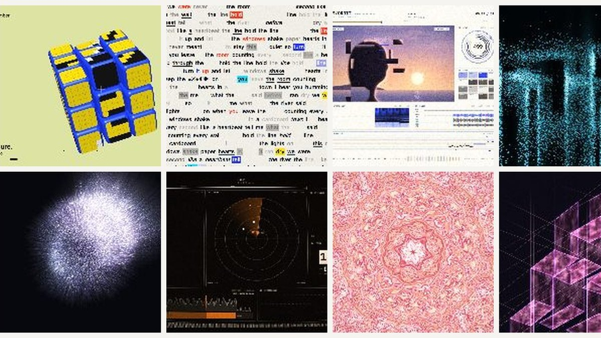
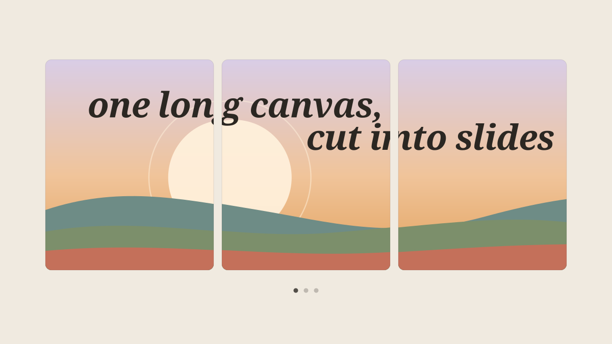

### Hey, I'm Nate 👋

Product designer in San Francisco. I love designing, and I love digging into the way people think.

By day I'm a marketing associate at Brick & Timber. The rest of the time I build the tools I wish existed, usually because I needed one for work or for myself. I design them, then I ship them.

**→ See my work at [throughnateseyes.com](https://www.throughnateseyes.com)**

### What I'm building

<table>
  <tr>
    <td width="50%" valign="top">
      
       <b><a href="https://trybite.co">Bite</a></b> · social food journal
       A camera-first food diary on the App Store, where your meals feed your friends' recommendations.
    </td>
    <td width="50%" valign="top">
      
       <b><a href="https://github.com/throughnateseyes/hum">Hum</a></b> · sound → sight
       Turns a song into a music video in your browser, with visuals that react to every hit and cut on the drops.
    </td>
  </tr>
  <tr>
    <td width="50%" valign="top">
      
       <b><a href="https://github.com/throughnateseyes/spread">Spread</a></b> · design canvas Claude can drive
       A free, local canvas for seamless carousels, emails and page layouts. Built to replace a carousel app plus Figma.
    </td>
    <td width="50%" valign="top">
      
       <b><a href="https://github.com/throughnateseyes/macro-manager">Macro Manager</a></b> · text expansion
       Type a short abbreviation anywhere and it expands into saved text, on Mac and Windows. My team uses it every day.
    </td>
  </tr>
</table>

Also: **[Playbook](https://github.com/throughnateseyes/playbook)**, a workspace for team SOPs, with every procedure a front desk runs behind one search box.

### Say hello

  &nbsp;
  &nbsp;
  &nbsp;
  

